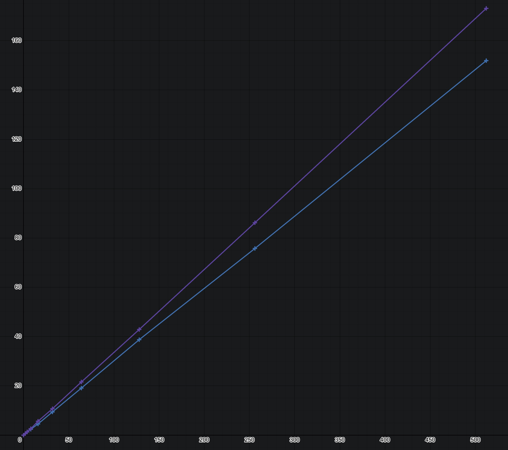

# Overcrypt

Overcrypt is an experimental encryption algorithm inspired by Neural Networks. It uses a Layered Shift-Substitute (LSS) approach to scramble text and binary data.

> _Disclaimer:
Overcrypt is an experiment. It is almost certainly not cryptographically secure, considering that I'm the one who made it. Use this at your own risk, and please don't use it for sensitive information._

## Substitution

This weekend project started as a simple **Caesar Cipher**, where every character is shifted up by a _shift factor_ $(S)$. The main flaw with this is that an attacker finding part of the plaintext makes it trivial to find which $S$ was used. Brute-forcing this system with a computer is also incredibly easy, due to there being only 25 possible shift factors for the English alphabet (50 if it includes both uppercase and lowercase letters).

To prevent this, I implemented a **character substitution** system. A random sequence of length $V$ (vocabulary size) is generated, containing unique numbers between $0$ and $V-1$. This is then used to map every input $x$ to an output using that random permutation rather than a static $S$. Also, the amount of possible combinations for the key changes from $V$ to $V!$

<br>

$$
f(x) = map(x)
$$

<br>

## Shifting

While **substitutions** make it more difficult to figure out the key from encrypted text, it still exposes the patterns from the plaintext, creating a vulnerability.

<div align="center">

|Original Character|Substitute Mapping|
|:---:|:---:|
|H|A|
|E|B|
|L|C|
|O|D|
|A|O|
|B|L|
|C|E|
|D|H|

</div>

If the above mapping is used as an example, _"HELLO"_ would become _"ABCCD"_, retaining the repeated letter. This could then be used to determine word structure and spacing.

**Shifting** prevents this via a $delta$ factor $(\delta)$, consisting of $4$ numbers, each between $2$ and $V-1$ inclusive.

$$
\delta_0,\;\delta_1,\;\delta_2,\;\delta_3
$$

The shift for a character is calculated as shown below, where $I$ is the character's absolute position in the text, $V$ is the vocabulary size, and $x_{-1}$ is the previous character:

$$
S \;=\; \left(I^{\delta_0} \bmod V \;+\; \delta_1 \cdot (I \bmod V) \;+\; \delta_2 \;+\; x_{-1} \cdot \delta_3\right) \bmod V   
$$

$I^{\delta_0}$ introduces non-linearity, while the constant $\delta_2$ ensures $S>0$ when $I=0$ and $x_{-1}=0$ (no prior character). $\;x_{-1} \cdot \delta_3$ makes the shift dependent on the previous character, meaning that any change to a character earlier in the sequence propagates throughout the rest. This also lets the IV (explained later) seed the chain, so identical plaintexts map to different outputs. Additionally, it prevents repeated shift patterns, as the output now depends on the actual character values rather than purely on $I$ and $\delta$. $\;I^{\delta_0}$ is calculated using modular exponentiation, since evaluating the full power for a large $I$ would produce a uselessly large intermediate.

```python
pow(idx, self.deltas[0], self.warp)
```

The shift is applied before substituting the character. Using the table above (with the _"ABCCD"_ example) and $\delta_0 = 1,\;\delta_1 = 0,\;\delta_2 = 1,\;\delta_3 = 0\;$ (for simplicity), _"HELLO"_ becomes _"BDLEA"_, successfully masking any repeated characters. Using this on a full vocabulary (such as ASCII's 95 printable characters) creates a much more random output.

<br>

$$
f(x) = map(x + S)
$$

<br>

## Layers

Despite **shifting** and **substitutions** masking the original plaintext and its character patterns, a single block can still theoretically be reverse-engineered if an attacker knows enough of the plaintext. To prevent this, I've implemented a **layering** system.

In this system, $x$ is passed sequentially through multiple Shift-Substitute blocks, where the output of one block is the input for the next. This creates an intermediary state where the final output relies on the cumulative transformation of every layer prior to it. Typically, stacking substitution layers causes all the mappings to collapse into a single map. But much like non-linear activations in a Neural Network, the shifts prevent the linear mapping layers from collapsing.

<br>

$$
l_n(x) = map_n(x + S_n)
$$

$$
f(x) = l_n \circ l_{n-1} \circ \cdots \circ l_1 \circ l_0(x)
$$

<br>

## Initialisation Vector (IV)

Most modern encryption algorithms use an IV - a random value used alongside the key to make sure $f(x)$ returns different ciphertexts for identical plaintexts. This ensures that encrypting the same message twice never leaks patterns.

To cover that vulnerability, I also used an IV. 4 random characters (chosen from the vocabulary) are prepended to the beginning of $x$ prior to encryption. The IV then seeds the initial $x_{-1}$ state at the start of the shift chain. As the shift of every subsequent character depends on the previous one $(\delta_3)$, the IV's randomness propagates throughout the rest of $x$, meaning that as long as the IV is random (the Python implementation uses the secrets crate), identical plaintexts will encrypt as two unique ciphertexts every time.

The table below shows the total amount of possible starting combinations of IV lengths 1-5 different vocabulary sizes, calculated as $V^N$ where $N$ is the amount of IV values.

|IV characters|Text $(V = 96)$|Binary $(V=256)$|
|:---:|:---:|:---:|
|1|$96$|$256$|
|2|$9,216$|$65,536$|
|3|$884,736$|$16,777,216$|
|4|$84,934,656$|$4,294,967,296$|
|5|$8,153,726,976$|$1,099,511,627,776$|

## Binary

Initially, I built this algorithm purely for text. But when I expanded it to handle binary data, I realised the architecture could remain the exact same, and that I could simply map every possible 8-bit byte to a fixed vocabulary of 256. Aside from setting $V = 256$ and dropping the character to integer conversion overhead, the binary version is structurally identical to the text version.

## Benchmarks

I originally designed LSS to be as secure as possible – whether it actually achieves that depends entirely on any vulnerabilities I may have missed. To evaluate its real-world performance, the benchmarks below measure the average time required to encrypt 1KB of data over 1,000 runs, for both text and binary implementations (still thousands of times slower than AES). I've also added the Parameter Count (total numbers in keychain), calculated as $L\cdot(V+4)$, where L is the number of layers. And also Theoretic Key Space (total possible amount of key combinations), calculated as $\left(V! \cdot (V-2)^4\right)^L$.

<br>

#### Text

|LSS Layers|Avg. Encryption Time|Parameter Count|Theoretical Key Combinations|
|:---:|:---:|:---:|:---:|
|2|0.67 ms|200|$5.995\times10^{315}$|
|4|1.30 ms|400|$3.594\times10^{631}$|
|8|2.39 ms|800|$1.291\times10^{1,263}$|
|16|4.53 ms|1,600|$1.668\times10^{2,526}$|
|32|9.42 ms|3,200|$2.781\times10^{5,052}$|
|64|19.10 ms|6,400|$7.735\times10^{10,104}$|
|128|38.74 ms|12,800|$5.983\times10^{20,209}$|
|256|75.73 ms|25,600|$3.579\times10^{40,419}$|
|512|151.93 ms|51,200|$1.281\times10^{80,839}$|

---


#### Binary

|LSS Layers|Avg. Encryption Time|Parameter Count|Theoretical Key Combinations|
|:---:|:---:|:---:|:---:|
|2|0.65 ms|520|$1.275\times10^{1,033}$|
|4|1.37 ms|1,040|$1.625\times10^{2,066}$|
|8|2.62 ms|2,080|$2.641\times10^{4,132}$|
|16|5.65 ms|4,160|$6.977\times10^{8,264}$|
|32|10.72 ms|8,320|$4.868\times10^{16,529}$|
|64|21.58 ms|16,640|$2.370\times10^{33,059}$|
|128|42.87 ms|33,280|$5.616\times10^{66,118}$|
|256|86.17 ms|66,560|$3.154\times10^{132,237}$|
|512|173.12 ms|133,120|$9.947\times10^{264,474}$|

---


The graph above shows the benchmark results. The blue line represents Overcrypt-Text $(V = 96)$, and the purple line represents Overcrypt-Binary $(V = 256)$. As shown, increasing the layer count scales encryption time linearly, while expanding the vocabulary size only adds a minor overhead penalty.

## Licence

This project is licensed under the MIT License
